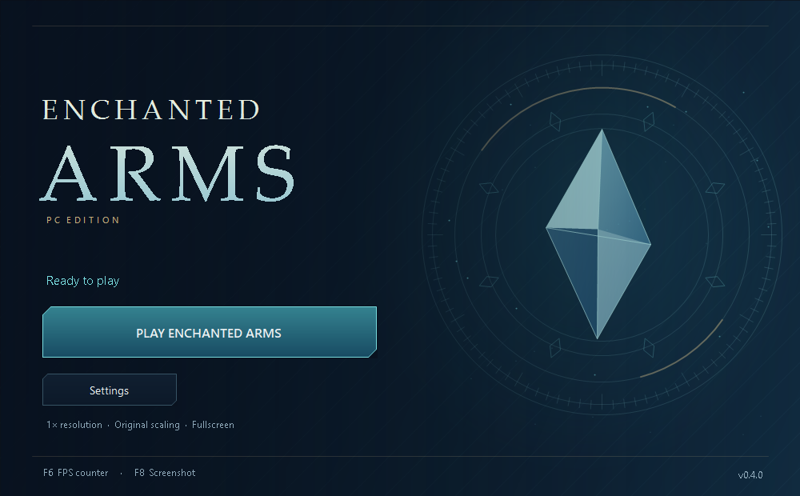

# EnchantedArmsPC

**An unofficial native PC recompilation of Enchanted Arms for Xbox 360.** Build and play on Windows using your own supported disc image.

[Download the Windows kit](https://github.com/IAndrewJJ/EnchantedArmsRecomp/releases/tag/v0.4.0) · [Known issues](docs/KNOWN_ISSUES.md) · [Build from source](docs/BUILDING.md) · [Contribute](CONTRIBUTING.md)

[](https://github.com/IAndrewJJ/EnchantedArmsRecomp/actions/workflows/launcher.yml)



## Start playing

1. Download **EnchantedArmsPC-0.4.0-windows-x64.zip** from the release's **Assets** section. Extract the entire ZIP into a writable local folder and keep its files together.
2. Open **EnchantedArmsLauncher.exe**. Choose **Set up game**, select your Xbox 360 ISO under **Settings → Game**, then **Build game**.
3. When setup finishes, click **Play Enchanted Arms**. The launcher always opens first; shortcuts never start the game automatically.
4. Use **Settings → Graphics** for visual presets, **Display** for window/FPS options, or **Game → Create desktop shortcut** for an **EnchantedArmsPC** desktop icon.

Requires **Windows 10/11 x64**, **.NET Framework 4.8** and a **Direct3D 12 GPU**. First setup downloads about **800 MB** of pinned build tools and needs roughly **20 GB free** in addition to the ISO. Compilation takes several minutes. Python and Visual Studio do not need to be installed separately.

The ready-to-run launcher is in the complete release ZIP. GitHub's source ZIP and the CI launcher-only artifact do not include the renderer and bootstrap files needed for player setup.

## Current status

**Early preview.** Opening battles, exploration, audio, menus, save creation and save loading have been exercised. Full campaign compatibility and clean-machine installation still need broader testing.

- Some NPCs are invisible, and Toya, Makoto and other NPCs can have dark surface patches. These remain under investigation.
- Mild stutter has been reported. Repeatable measurements and broader GPU/controller coverage are needed.
- **Use Original FPS for normal play.** Experimental limits up to 360 FPS and Unlimited can accelerate gameplay. A normal-speed high-FPS engine timing patch is not implemented. [Upstream testing](https://github.com/xenia-canary/game-compatibility/issues/2) reports the same frame dependence.

See [known issues](docs/KNOWN_ISSUES.md) and [playtesting guidance](docs/PLAYTESTING.md) for details. The launcher polish in 0.4.0 does not establish a campaign-wide FPS improvement.

## Graphics

| Preset | Internal scale | Output effect | Antialiasing | Filtering |
| --- | --- | --- | --- | --- |
| Original | 1× | Bilinear | Game requested | Game requested |
| Balanced | 1× | FSR 1 | FXAA | 8× AF |
| Enhanced | 2× | FSR 1 | FXAA | 8× AF |
| High | 3× | CAS | FXAA | 16× AF |
| Ultra | 4× | CAS | FXAA strong | 16× AF |

Settings apply on the next game launch. Internal resolution is separate from window size. Start with Original to establish a baseline: 2×, 3× and 4× render four, nine and sixteen times the native pixel count.

FSR 1 provides spatial upscaling; CAS provides sharpening. Texture detail selects sharper existing mipmaps, with possible shimmer at Strong. Source textures and movies keep their original detail. Temporal FSR, frame generation and replacement texture packs are not implemented.

**Settings → Advanced** contains ROV/RTV, resolve readback and background shader compilation comparisons. Change one option at a time when investigating rendering problems. Immediate readback can stall heavily; these controls are not confirmed NPC fixes.

## Controls

| Keyboard | Action |
| --- | --- |
| Enter / X | Start |
| Space / semicolon | A / confirm |
| Backspace / apostrophe | B / back |
| L / P | X / Y (menus) |
| W A S D | Left stick |
| Arrow keys | Right stick |
| Shift + arrows | D-pad |
| F6 | Toggle FPS counter |
| F8 | Save screenshot |
| Alt + F4 | Close |

Briefly hold a key if a short tap is missed. A pinned SDL controller database is included; physical controllers need broader testing. F6 counts game swap submissions, not monitor refresh or GPU execution time. F8 captures guest output before presenter effects and overlays and can briefly pause rendering.

## Supported game and updates

Only the **USA/Europe Xbox 360 release**, title `555307E6`, media `41637F65`, XEX version `0.0.0.1`, is supported. Required XEX SHA-256:

```text
79e95ea830119123c2fd9c7b08fb890c4cf40cc6b8422b3568a820b6b3779f22
```

Setup opens the ISO read-only and rejects unsupported executables before extraction. Files, translated code and compilation stay on the player's PC.

To update, close the game and launcher, keep a private backup of `.local/runtime/user`, and unpack the new kit over the existing project while preserving `.local` and `bin`. **The 0.4.0 launcher uses native build 0.3.2; existing 0.3.2 players do not need to rebuild.** For earlier native builds, use **Settings → Game → Rebuild game**. Keep the installation folder in place, or recreate the desktop shortcut after moving it.

Local data lives under `.local`: `runtime/user` for saves, `runtime/cache` for shader caches, `runtime/captures` for F8 images, and `runtime/boot-*.log` plus `logs` for diagnostics. Rebuilding preserves saves and caches. Report/log/save-management buttons have been removed from the simplified interface.

## Development

Built with **ReXGlue SDK 0.10.0**, using a Xenia-derived renderer. See [build and validation instructions](docs/BUILDING.md), [contributor guidance](CONTRIBUTING.md), [changelog](CHANGELOG.md) and [roadmap](docs/ROADMAP.md).

This is an unofficial fan project. No ISO, game executable, game assets, translated game source or saves are distributed. Original contributions use the [MIT license](LICENSE); runtime components retain their own [licenses and notices](THIRD_PARTY_NOTICES.md). Corresponding renderer source accompanies the Windows release.
