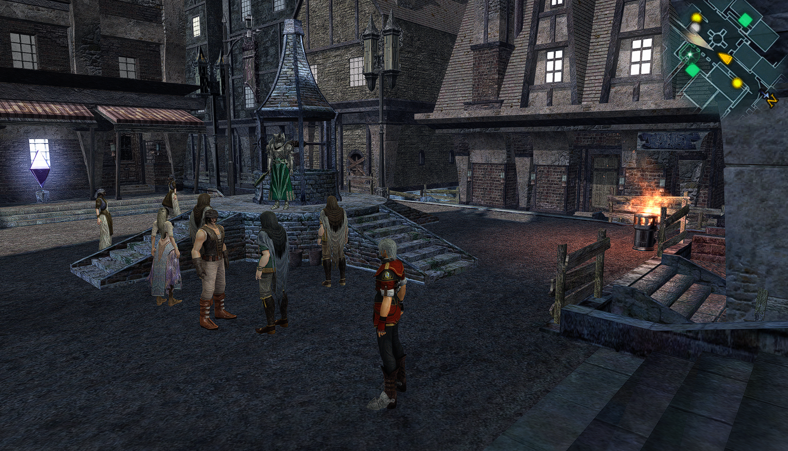
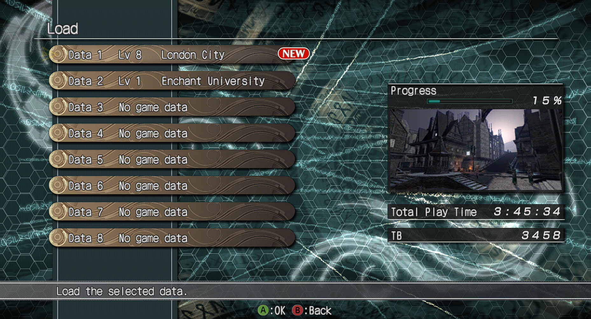
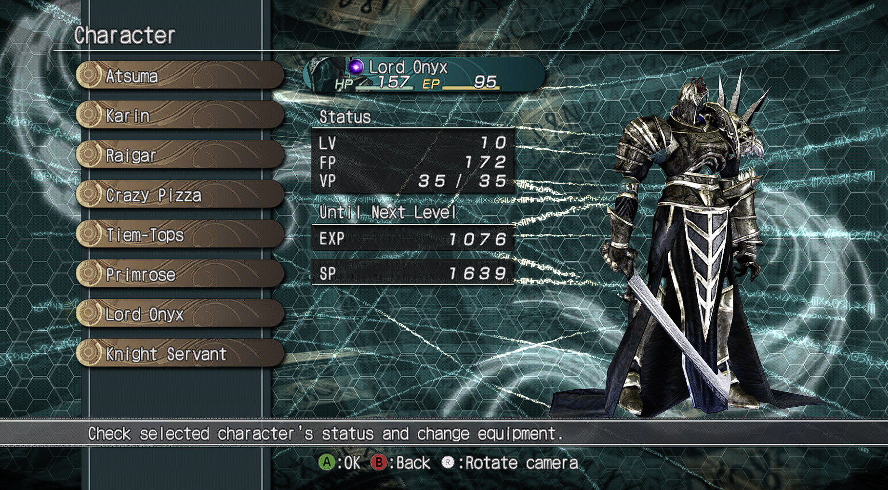

  

# EnchantedArmsPC

**Revisit Enchanted Arms on PC with clearer graphics and smoother gameplay.**

A fan-made PC version of the Xbox 360 RPG, built from your own copy of the game.

**[Download for Windows](https://github.com/IAndrewJJ/EnchantedArmsRecomp/releases/tag/v0.5.8)**

**[Download for Linux — AppImage preview](https://github.com/IAndrewJJ/EnchantedArmsRecomp/releases/download/linux-v0.1.0/EnchantedArmsPC-linux-0.1.0-x86_64.AppImage)** · [Linux release notes](https://github.com/IAndrewJJ/EnchantedArmsRecomp/releases/tag/linux-v0.1.0)

## What’s better on PC?

- **Smoother gameplay.** Choose 30 or 60 FPS.
- **Clearer visuals.** Turn up the resolution, sharpen the picture, and smooth rough edges.
- **Your choice of controls.** Use a controller or keyboard and mouse, with customizable buttons and camera settings.
- **A simple launcher.** Adjust your settings, check for updates, and press Play when you’re ready.
- **Handy extras.** Take screenshots, show an FPS counter, and create a desktop shortcut.
- **Optional cheats on Windows.** Adjust health, ability energy, money, upgrades and experience from the launcher.

   
  
  

## Get started

### Windows

1. Download **EnchantedArmsPC-0.5.8-windows-x64.zip** from the release page and extract it into its own folder.
2. Open **EnchantedArmsLauncher.exe**, select your game ISO, then choose **Build game**. The default locations keep the launcher, game and saves together.
3. Choose your settings and click **Play Enchanted Arms**.

You’ll need Windows 10 or 11, your own supported USA/Europe Xbox 360 ISO, and around 20 GB of free space beyond the ISO. First setup needs an internet connection and takes several minutes. See [setup help and requirements](docs/SETUP_TROUBLESHOOTING.md) if you need a hand.

Updating? Use **Settings → Updates**. If the launcher offers **Update Game**, rebuild from your ISO to apply the game fixes. Your saves and settings are kept.

Your saves are in **Saves** inside the game folder. Prefer another location? Choose it under **Settings → Game → Save location** with the game closed. Your existing progress is copied safely.

### Linux preview

1. Download [**EnchantedArmsPC-linux-0.1.0-x86_64.AppImage**](https://github.com/IAndrewJJ/EnchantedArmsRecomp/releases/download/linux-v0.1.0/EnchantedArmsPC-linux-0.1.0-x86_64.AppImage).
2. In your file manager’s properties, allow it to run as a program, then open it.
3. Under **Settings → Game**, choose your ISO and build folder, then **Build game**. When it finishes, click **Play Enchanted Arms**.

This is an experimental Linux preview; gameplay on Linux hardware has not yet been verified. See the [Linux setup guide](https://github.com/IAndrewJJ/EnchantedArmsRecomp/blob/linux-v0.1.0/linux/README.md) for requirements and help.

## Still being tested

Saving, loading, menus, and early gameplay have been tested. A full playthrough is still in progress. Some characters may be invisible or shaded incorrectly, and brief stutters can occur. Check the [known issues](docs/KNOWN_ISSUES.md) or [report a problem](https://github.com/IAndrewJJ/EnchantedArmsRecomp/issues/new/choose) to help improve the game.

---

An unofficial fan project, unaffiliated with the game’s creators or publishers. Game files are not included. [License](LICENSE) · [Credits and notices](THIRD_PARTY_NOTICES.md)
